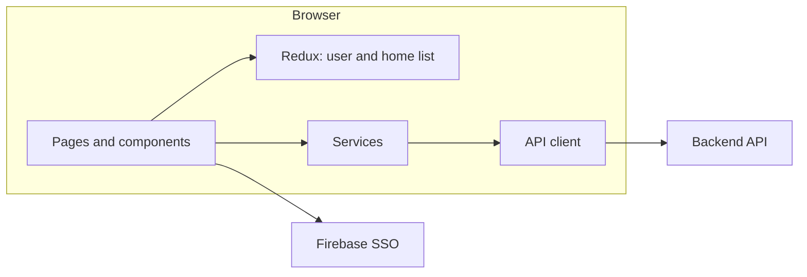
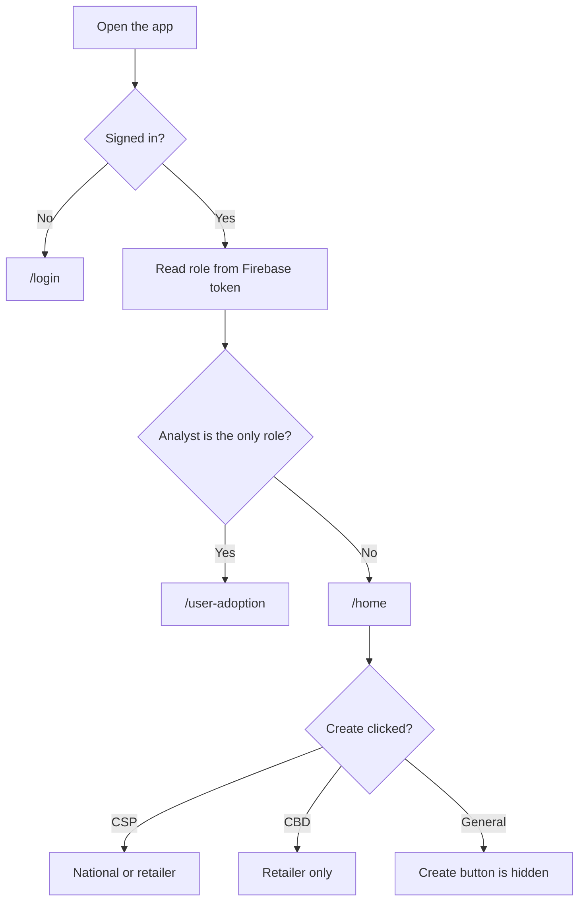
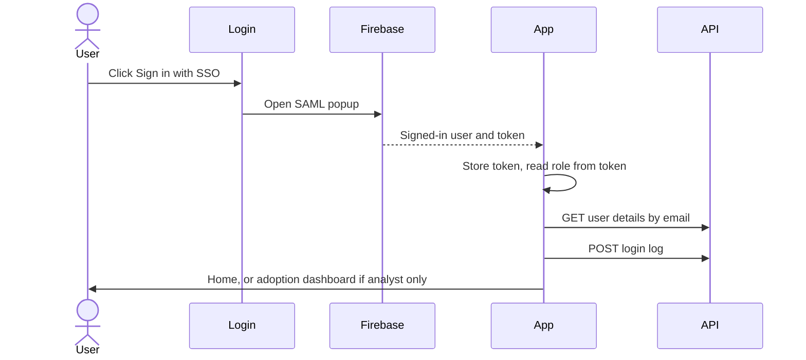
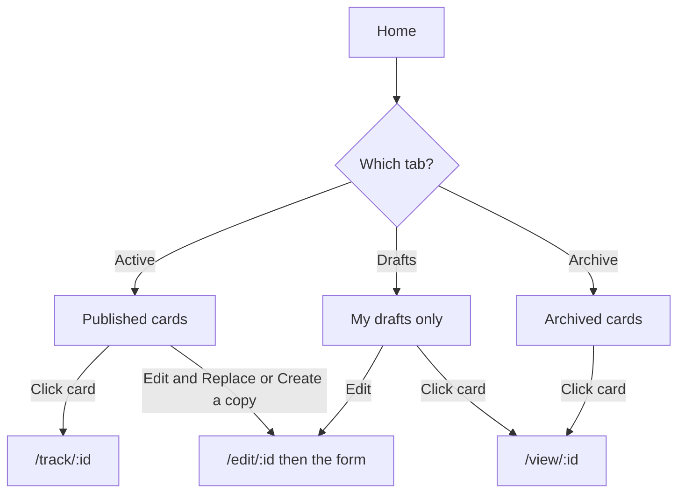
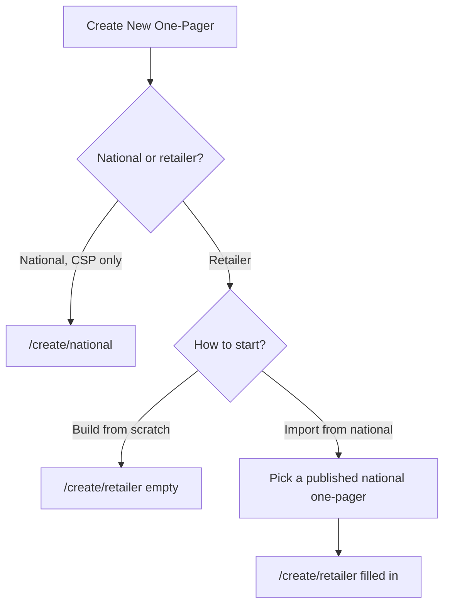
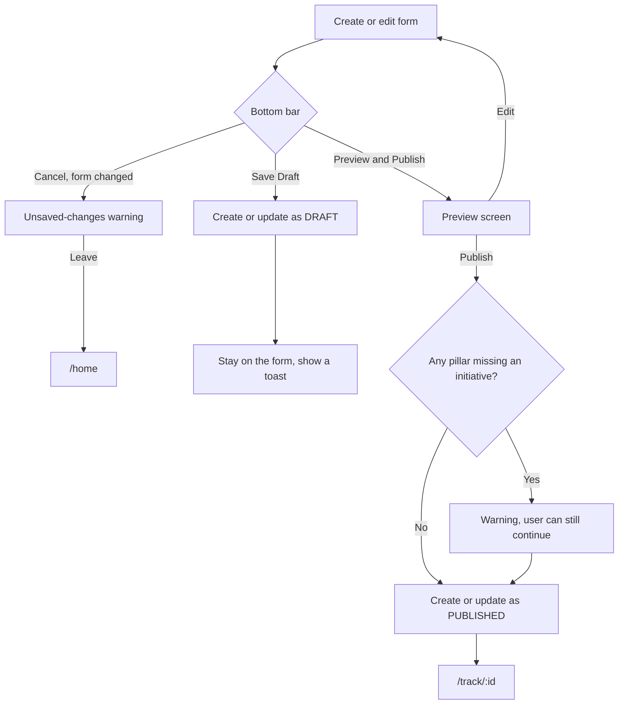
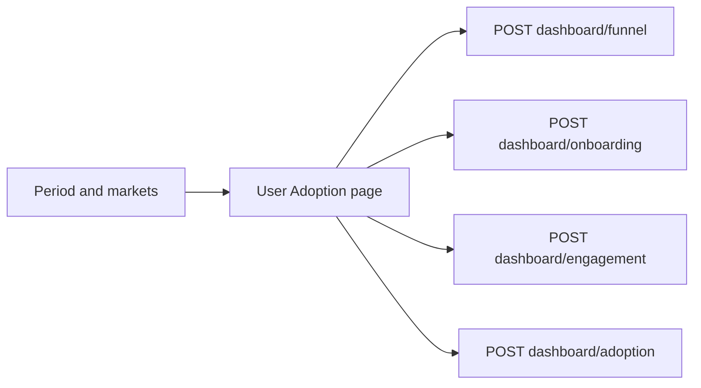
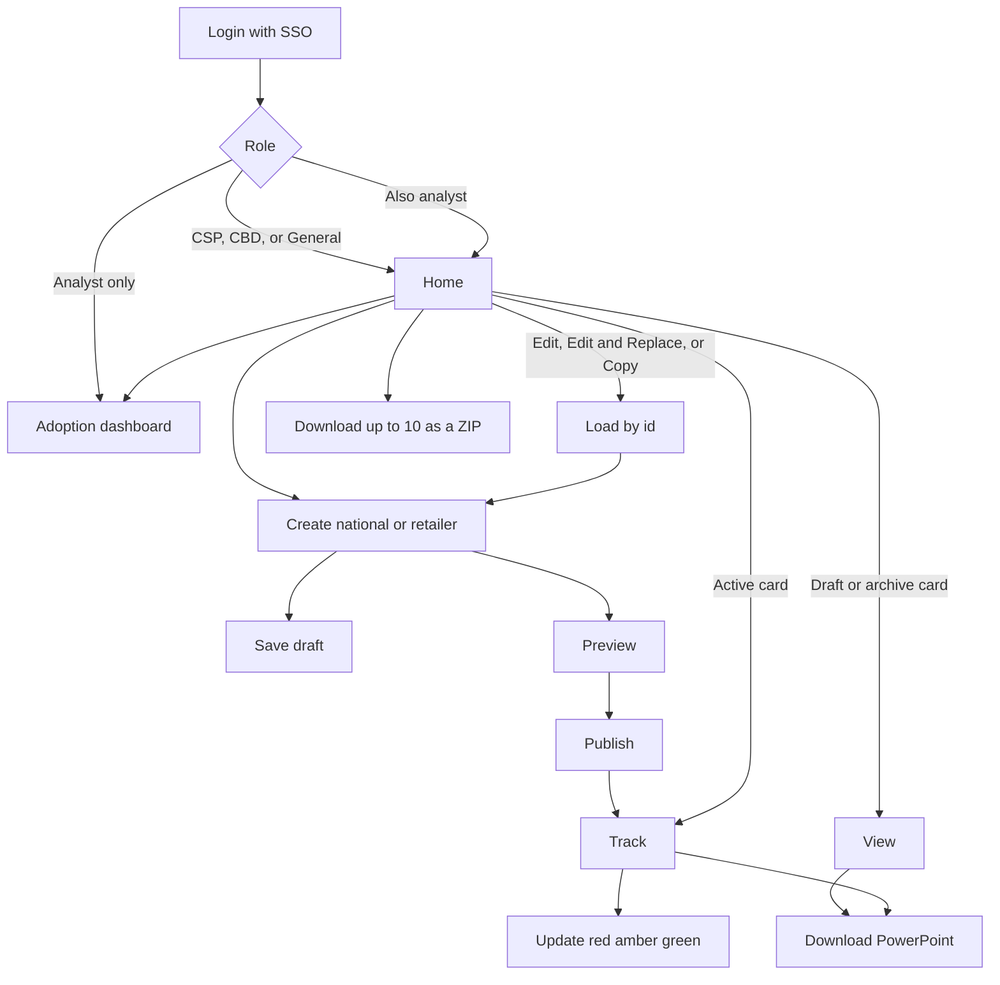

# Category One-Pager — frontend knowledge transfer

This is a map of the frontend for a developer who has not opened the code yet. It explains what the app does, how a user moves through it, which folder owns each part, and which backend API each step calls.

It stays at the flow level. File names are here so you can open the right place. It does not walk through functions line by line.

Diagrams are [Mermaid](https://mermaid.js.org/). GitHub, Cursor, and most Markdown previews draw them as pictures.

---

## 1. What this app is

A signed-in Unilever user manages **category one-pagers**.

A one-pager is a one-page plan for a market, category, and year. It has a strategy section on top and five fixed pillars underneath. Each pillar can hold up to three initiatives.

There are two kinds, and they stay separate:

| Kind | Who it is for | Extra field |
| --- | --- | --- |
| National | A whole market | No target retailer |
| Retailer | One retailer inside a market | Target retailer is required |

A retailer one-pager can be started empty, or started by copying a published national one-pager and then editing it.

People use the app to:

- Sign in with company SSO
- Browse, filter, and open one-pagers
- Create, save a draft, preview, and publish
- Edit their own one-pager, or publish a copy
- Track progress on a published one-pager
- Download a PowerPoint
- See an adoption dashboard, if their role includes analyst

---

## 2. How the app is put together

React + TypeScript, built with Vite. Styling is Tailwind. Shared buttons, dialogs, and dropdowns come from a small UI kit in `src/components/ui`.

Three ideas matter more than the libraries:

1. **A page is a screen.** Each URL has one file in `src/pages`.
2. **A service is a backend call.** Screens do not build HTTP requests themselves. They call a function in `src/services`.
3. **The create form keeps its own data.** National and retailer forms use local React state. They are not stored in Redux. Redux is only for the signed-in user, the home list, and the app name.

Every backend call goes through one HTTP client, `src/components/auth/apiBase.ts`. That client:

- Uses `VITE_API_BASE_URL` as the server address
- Attaches the Firebase sign-in token as `Authorization: Bearer …`
- Sends the user back to login if the server answers `401`

API paths live in one file: `src/config/apiEndpoints.ts`. Change a path there, not inside each screen.

### Start-up order

`src/main.tsx` puts Redux around the app. `src/App.tsx` then wraps everything in a tooltip provider and the auth provider. Routes live in `src/routes/routes.tsx`.

After a successful sign-in, `src/layouts/MainLayout.tsx` does three things before the screen is useful:

1. Reads the signed-in person from the Firebase token and stores them in Redux.
2. Asks the backend who that email is (market and role for activity logs).
3. Posts a login log. A failure here does not block the app.

---

## 3. Folder map — where to look

Everything product-related is under `frontend/src`.

| Folder | Open this when you need to… |
| --- | --- |
| `pages/` | Change what a whole screen does. One file per URL. |
| `routes/` | Add a URL, or change who is allowed to open it. |
| `layouts/` | Change the shell: header, back button, page title. |
| `components/landing/` | Change the home list: cards, filters, create popup, archive, delete, restore. |
| `components/form/` | Change the create/edit form: strategy fields, pillars, initiatives, save bar. |
| `components/preview/` | Change how a one-pager looks on screen before or after publish. |
| `components/track/` | Change the red/amber/green dots on the track screen. |
| `components/adoption/` | Change the adoption dashboard charts and filters. |
| `components/auth/` | Change login gating and role checks. |
| `components/layout/` | Change the top bar or the page width wrapper. |
| `components/ui/` | Change a shared control (button, dialog, select). No product rules here. |
| `services/` | Change a backend call, the PowerPoint file, or how an API response is turned into app data. |
| `redux/` | Change shared user data or the home list. Not the create form. |
| `types/` | Change the shape of a one-pager list item or a home filter. |
| `config/` | Change an API path, the Firebase setup, or which PowerPoint builder is active. |
| `constants/` | Change help links and dashboard tooltip text. |
| `lib/` | Change small helpers: dates, years, saved home filters. |
| `assets/` | Logos, pillar icons, fonts. |

### Pages and URLs

| URL | Screen file | What the user sees |
| --- | --- | --- |
| `/login` | `pages/Login.tsx` | SSO sign-in |
| `/home` | `pages/Home.tsx` | List of one-pagers |
| `/create/national` | `pages/CreateNationalOnePager.tsx` | National form |
| `/create/national/preview` | `pages/PreviewNationalOnePager.tsx` | National preview, then publish |
| `/create/retailer` | `pages/CreateRetailerOnePager.tsx` | Retailer form |
| `/create/retailer/preview` | `pages/PreviewRetailerOnePager.tsx` | Retailer preview, then publish |
| `/edit/:pagerId` | `pages/EditOnePager.tsx` | Loads one one-pager, then opens the matching form |
| `/view/:pagerId` | `pages/ViewOnePager.tsx` | Read-only document for drafts and archived items |
| `/track/:pagerId` | `pages/TrackOnePager.tsx` | Published one-pager plus status dots |
| `/user-adoption` | `pages/UserAdoption.tsx` | Adoption dashboard |

`/edit/:pagerId` is not a form. It loads the record and immediately opens `/create/national` or `/create/retailer` with that record already filled in.

---

## 4. Who can do what

The signed-in person is built in `services/userApi.ts` from the Firebase token, then stored by `redux/userSlice.ts`.

The token carries a role list. The app splits that list into two ideas:

- **Job role:** CSP, CBD, or General. If several are present, the highest one wins (CSP, then CBD, then General).
- **Analyst flag:** separate. It does not replace the job role, unless analyst is the only role.

Inside the code the job roles are named `user_type_1`, `user_type_2`, and `user_type_3`. On screen they show as CSP, CBD, and General.

The owner of a one-pager is the **email** stored as `created_by`. “My one-pagers” and edit/delete checks compare emails.

| Person | Home and one-pagers | Create national | Create retailer | Edit, archive, delete, restore | Adoption dashboard |
| --- | --- | --- | --- | --- | --- |
| CSP | Yes | Yes | Yes | Yes, and only on ones they own | Only if the token also includes analyst |
| CBD | Yes | No | Yes | Yes, and only on ones they own | Only if the token also includes analyst |
| General | Yes, view and export | No | No | No | Only if the token also includes analyst |
| Analyst only | No. They are sent to the dashboard | No | No | No | Yes |
| CSP, CBD, or General **and** analyst | Same as their job role | Same as their job role | Same as their job role | Same as their job role | Yes. A dashboard link appears in the header |

General users do not see the Drafts tab or the “My one-pagers” tab. They also do not see the Create button.

Route guards (the files that enforce this):

| Guard | File | Effect |
| --- | --- | --- |
| Must be signed in | `components/auth/RequireAuth.tsx` | Otherwise go to `/login` |
| Must not be analyst-only | `components/auth/RequireOnePagerAccess.tsx` | Analyst-only users go to `/user-adoption` |
| Must be allowed to create that kind | `components/auth/RequireUserCreateAccess.tsx` | Otherwise go back to `/home` |
| Must be an analyst | `components/auth/RequireAnalyst.tsx` | Otherwise go to `/home` |

---

## 5. Sign-in

**Screen:** `pages/Login.tsx`  
**SSO:** `services/authService.ts` opens a Firebase SAML popup (company Azure AD).  
**Session:** `components/auth/AuthProvider.tsx` watches Firebase. On success it stores the ID token in the browser under `firebaseToken`. Closing the popup is not treated as an error.

If the person is already signed in, `/login` sends them to `/home`. The route guard then sends an analyst-only user on to the dashboard.

**Setup values** (names only, in the frontend env file):

- `VITE_API_BASE_URL` — backend address
- `VITE_REACT_APP_FIREBASE_API_KEY`
- `VITE_REACT_APP_FIREBASE_AUTH_DOMAIN`
- `VITE_REACT_APP_FIREBASE_PROJECT_ID`
- `VITE_REACT_APP_FIREBASE_APP_ID`
- `VITE_REACT_APP_FIREBASE_SAML_PROVIDER_ID` — which SSO provider to open
- `VITE_APP_NAME` — optional app title

Firebase itself is started in `config/firebaseConfig.ts`. The session is kept in the browser (`browserLocalPersistence`), so a refresh does not sign the user out.

**Backend calls after sign-in** (from the main layout, not from the login button):

| Plain meaning | Method and path | Service file |
| --- | --- | --- |
| Who is this email (market and role for logs) | `GET api/v1/user-tracking/user-details` | `services/userDetailsApi.ts` |
| Record that this person opened the app | `POST api/v1/user-tracking/login-log` | `services/loginLogApi.ts` |

The login log is sent once per full page load, including a restored session. Moving between screens does not send it again. If it fails, the user still enters the app.

Sign-out is in the header menu (`components/layout/AppHeader.tsx`). It clears Firebase and the stored token, then returns to `/login`. It also clears the saved home filters.

---

## 6. Home

**Screen:** `pages/Home.tsx`  
**List state:** `redux/landingSlice.ts`  
**Card:** `components/landing/OnePagerCard.tsx`  
**Filters:** `components/landing/FilterBar.tsx`

On open, home does two things:

1. Loads dropdown options (markets, retailers, channels, and so on).
2. Loads the one-pager list. If the user had applied filters earlier in this browser tab, those filters are restored from `sessionStorage` (`lib/homeFilterStorage.ts`) and sent with the list request.

Status tabs (Active / Drafts / Archive) and All vs My are **not** saved. They reset when the page is fully reloaded.

### What the tabs mean

| Tab on screen | Status stored on the one-pager |
| --- | --- |
| Active | `PUBLISHED` |
| Drafts | `DRAFT` |
| Archive | `ARCHIVED` |

Drafts always show “My” only. Active and Archive can show All, or My. General users only see All, and they never see Drafts.

Filters are market, retailer, channel, category, campaign, business group, and year. Retailer, channel, category, campaign, and business group depend on the chosen markets. Choosing a market narrows those lists. The user must press Apply. Clear wipes the saved filters.

### Opening a card

| Status | Clicking the card opens |
| --- | --- |
| Published | `/track/:id` |
| Draft | `/view/:id` |
| Archived | `/view/:id` |

### Card menu

| Status | Menu items |
| --- | --- |
| Published | Export, Archive, Edit & Replace, Create a copy, Delete |
| Draft | Edit, Delete |
| Archived | Export, Restore, Delete |

General users only keep Export. Edit, archive, restore, and delete also require the signed-in email to match `created_by`.

- **Edit** opens the draft in the form.
- **Edit & Replace** opens the published one-pager in the form and later updates the same record.
- **Create a copy** opens the form filled in, but save/publish creates a **new** one-pager.
- **Archive** sets status to `ARCHIVED`.
- **Restore** sets status back to `DRAFT`, not Active.
- **Delete** sets status to `DELETED`. The card leaves the list. This is a status change, not a hard delete.

On Active and Archive, the user can tick up to 10 cards and download them as one ZIP. Drafts cannot be bulk-exported.

**Backend calls:**

| Plain meaning | Method and path | Service file |
| --- | --- | --- |
| Dropdown options for filters and forms | `GET api/v1/metadata` | `services/metadataApi.ts` |
| One-pager list for the current filters | `POST api/v1/pagers/fetch-all` | `services/onePagerApi.ts` (`submitOnePagerSearch`) |
| Archive, restore, or delete | `PATCH api/v1/pagers/{id}/status` | `services/onePagerApi.ts` |
| Several PowerPoints as a ZIP | `POST api/v1/pagers/export-bulk`, then the file is built in the browser | `services/multiExportApi.ts` |

The status call sends `{ status, updated_by }`. `status` is `ARCHIVED`, `DRAFT`, or `DELETED`.

---

## 7. Creating a one-pager

Create starts from the button on home, in `components/landing/CreateOnePagerModal.tsx`.

CBD users can open retailer only. The national choice is visible but blocked, with a short explanation.

National and retailer are **two screens**. They share the pillars section, the bottom action bar, the unsaved-changes warning, and the success toast. They do not share one form that hides the retailer field.

### What the form contains

Both forms have two parts:

1. **Strategy** — market, category, channel, campaign, business group, year, title, business outcome, cover image. Title is suggested from the strategy fields and can be edited.
2. **Pillars** — five fixed pillars. Each can have up to three initiatives. Each initiative can have up to three images. Scoring is unweighted or weighted. In weighted mode, pillar weights must add up to 100 before preview is allowed.

Retailer adds **target retailer**, and it is required.

Campaign, cover image, and business outcome are optional. Initiatives are recommended. A pillar with no initiative does not block preview, but publish asks the user to confirm.

Market must be chosen before category, channel, campaign, business group, and (on retailer) target retailer. Those options come from the same metadata call as the home filters.

| Form piece | File |
| --- | --- |
| National strategy fields | `components/form/NationalStrategyForm.tsx` |
| Retailer strategy fields | `components/form/RetailerStrategyForm.tsx` |
| Pillars and the initiative list | `components/form/PillarsSection.tsx` |
| Add or edit one initiative | `components/form/AddInitiativeModal.tsx` |
| Add a campaign that is not in the list | `components/form/AddCampaignModal.tsx` |
| Cancel, Save Draft, Preview & Publish | `components/form/FormActionBar.tsx` |
| “You have unsaved changes” | `components/form/UnsavedChangesModal.tsx` |
| Field values for national | `components/form/nationalForm.ts` |
| Field values for retailer | `components/form/retailerForm.ts` |
| Turn a saved one-pager back into form fields | `components/form/hydrateFromPayload.ts` |

The bottom bar:

- **Cancel** — if the form changed, ask before leaving. Then go home.
- **Save Draft** — allowed even when preview is blocked (for example weights do not add up to 100). Hidden when editing a published one-pager in place.
- **Preview & Publish** — enabled only when the required strategy fields are filled, and weights add up to 100 in weighted mode.

Images are uploaded as soon as the user picks a file. The form then stores the returned URL. It does not send the raw file on save.

### National

**Screen:** `pages/CreateNationalOnePager.tsx`  
**Save and publish:** `services/createFormApi.ts`

Preview is `/create/national/preview`. The form passes its current values in memory. Preview does not load the one-pager again.

### Retailer

**Screen:** `pages/CreateRetailerOnePager.tsx`  
**Save and publish:** `services/retailerCreateFormApi.ts`

Same bottom bar and same preview idea, on `/create/retailer/preview`.

**Import from national** (`components/landing/ImportFromNationalPicker.tsx`):

1. User filters and picks a published national one-pager. The picker uses the same list API as home.
2. The retailer screen loads that national one-pager by id.
3. Market, category, channel, and campaign are filled in and locked. The user still sets target retailer and can edit the rest, including pillars.

### Save rules

| Situation | What save does |
| --- | --- |
| Brand new, or “create a copy” | `POST api/v1/pagers` — new id |
| Editing an existing draft, or Edit & Replace | `PATCH api/v1/pagers/{id}` — same id |
| Save Draft | status `DRAFT` |
| Publish | status `PUBLISHED` |

Edit & Replace hides Save Draft. Publishing updates that same published one-pager. Create a copy leaves the original alone.

**Backend calls:**

| Plain meaning | Method and path | Service file |
| --- | --- | --- |
| Dropdown options | `GET api/v1/metadata` | `services/metadataApi.ts` |
| Upload a cover or initiative image | `POST api/v1/upload` | `services/imageUploadApi.ts` |
| Add a campaign that was not in the list | `POST api/v1/campaigns` | `services/createFormApi.ts` (`addCampaign`) |
| Create a national or retailer one-pager | `POST api/v1/pagers` | `createFormApi.ts` or `retailerCreateFormApi.ts` |
| Update an existing one | `PATCH api/v1/pagers/{id}` | same two files |
| Load the national one-pager being imported | `GET api/v1/pagers/{id}` | `services/createFormApi.ts` (`getNationalOnePager`) |
| Record “user saved a draft” | `POST api/v1/user-tracking/action-log` | `services/pagerActivityApi.ts` |

The activity log is fire-and-forget. If it fails, the save still succeeds. The same log is used later for view, export, and track. The `action` value is `draft`, `view`, `export`, or `track`.

---

## 8. Preview and publish

| Kind | Screen |
| --- | --- |
| National | `pages/PreviewNationalOnePager.tsx` |
| Retailer | `pages/PreviewRetailerOnePager.tsx` |

Both render `components/preview/NationalPreviewDocument.tsx`. Retailer shows target retailer when it is present. The on-screen document is the same component used by View and Track.

Before publish, the header title is prefixed with `(Preview)`. **Edit** returns to the form with the same in-memory values. Nothing is loaded from the server for that return trip.

**Publish** asks for confirmation. If any pillar has no initiative, `components/preview/PublishIncompletePillarsModal.tsx` warns first. The user can still publish.

After a successful publish, the app opens `/track/:id` and shows a short “now published” toast.

**Backend call:** the same create-or-update call as section 7, with status `PUBLISHED`.

---

## 9. Edit

**Screen:** `pages/EditOnePager.tsx`

This screen only loads the record and redirects. The user should barely see it.

1. `GET api/v1/pagers/{id}` via `services/onePagerApi.ts` (`getOnePagerById`).
2. The response is turned into form data by `services/mapGetOnePagerResponse.ts`.
3. If the signed-in email is not the owner, stop with an error.
4. If the role cannot create that kind (for example CBD opening a national one), stop with an error.
5. Open `/create/national` or `/create/retailer` with the record already in navigation state.

`createAsNew` in that navigation state means “create a copy”: the form is filled in, but the id is cleared so the next save creates a new one-pager.

---

## 10. View

**Screen:** `pages/ViewOnePager.tsx`

Used for drafts and archived one-pagers. It loads the same record as edit, then shows the document. There is no publish bar.

The header menu can export, edit, archive, restore, or delete, with the same owner and role rules as the home card. Export is omitted on drafts. After archive, restore, or delete, the user returns home.

Opening this screen also sends an activity log with action `view`.

**Backend calls:**

| Plain meaning | Method and path |
| --- | --- |
| Load this one-pager | `GET api/v1/pagers/{id}` |
| Archive, restore, or delete | `PATCH api/v1/pagers/{id}/status` |
| Record a view | `POST api/v1/user-tracking/action-log` |

PowerPoint is not a backend file. See section 12.

---

## 11. Track

**Screen:** `pages/TrackOnePager.tsx`

This is the screen for a **published** one-pager. Home opens it when an Active card is clicked. Publish also lands here.

It shows the same document, plus a status dot on each pillar and each initiative. Dots are red, amber, or green (`components/track/TrackStatusDot.tsx`). The current colours come from the loaded one-pager (`pillar_track` and `initiative_track`).

Changing a dot saves immediately.

**Backend calls:**

| Plain meaning | Method and path | Service file |
| --- | --- | --- |
| Load the one-pager, including current dots | `GET api/v1/pagers/{id}` | `services/onePagerApi.ts` |
| Save a pillar or initiative colour | `PATCH api/v1/update-track` | `services/trackApi.ts` |
| Record that the user opened track | `POST api/v1/user-tracking/action-log` with action `track` | `services/pagerActivityApi.ts` |

The track update sends the one-pager id, the pillar id, the initiative id (empty when the dot is on the pillar itself), and the new colour.

The header menu matches a published card: export, archive, edit and replace, create a copy, delete. Track itself is not in the menu, because the user is already on it.

---

## 12. PowerPoint download

Export builds the `.pptx` **in the browser**. The server is only asked for the one-pager data.

| How the user starts it | What happens |
| --- | --- |
| Export on one card, or on View / Track | Load that one-pager if needed, build one file, download it |
| Tick up to 10 cards on home, then export | `POST api/v1/pagers/export-bulk` returns those one-pagers, the browser builds one PowerPoint each, then downloads a ZIP |

There are two builders:

| Builder | File | When it is used |
| --- | --- | --- |
| Current layout | `services/exportOnePagerPpt.ts` | Default |
| Alternate layout | `services/exportOnePagerPptDynamic.ts` | Only when `USE_DYNAMIC_PPT_EXPORT` in `config/pptExport.ts` is `true` |

Leave that flag `false` unless you are intentionally switching the slide layout. Single export and ZIP export both follow the flag.

Each successful export also sends the activity log with action `export`. A log failure does not stop the download.

Drafts are not exported.

---

## 13. User adoption dashboard

**Screen:** `pages/UserAdoption.tsx`  
**Charts and sections:** `components/adoption/`  
**Filters and date ranges:** `lib/adoptionPeriod.ts`  
**Tooltip copy:** `constants/dashboardTooltips.ts`

Only people whose token includes analyst can open `/user-adoption`. Analyst-only users land here instead of home and do not see one-pager screens. Everyone else who is also an analyst gets a dashboard link in the header and can still use one-pagers.

The page has four blocks, loaded together: funnel, onboarding, engagement, and adoption. Filters are period (or custom dates) and markets. Market options come from the same metadata call as home.

If one block fails, that block shows empty numbers. The other blocks still render.

**Backend calls** (all `POST`, body is the selected period and markets):

| Block | Path | Service function |
| --- | --- | --- |
| Funnel | `api/v1/dashboard/funnel` | `getAdoptionFunnel` |
| Onboarding | `api/v1/dashboard/onboarding` | `getAdoptionOnboarding` |
| Engagement | `api/v1/dashboard/engagement` | `getAdoptionEngagement` |
| Adoption | `api/v1/dashboard/adoption` | `getAdoptionDashboard` |

All four live in `services/adoptionDashboardApi.ts`.

---

## 14. Shared state, in one picture

| Data | Where it lives | Survives refresh? |
| --- | --- | --- |
| Firebase user and token | Auth provider and browser storage | Yes, until sign-out or a 401 |
| Name, email, job role, analyst flags | `redux/userSlice.ts` | Rebuilt from the token on each load |
| Market and role used on activity logs | Same slice, from user-details | Re-fetched on each load |
| Home list, filters, Active/Drafts/Archive tab | `redux/landingSlice.ts` | List is re-fetched. Applied dropdown filters are restored from `sessionStorage`. Tabs are not. |
| Create/edit form, including a trip to preview | The page’s own state, passed through navigation | No. A refresh on the form loses unsaved edits. |
| App display name | `redux/appSlice.ts` | Read from `VITE_APP_NAME` |

Do not put the create form into Redux. Both forms are already built around local state, and preview depends on that in-memory handoff.

---

## 15. Backend calls in one list

All of these are called with the Firebase bearer token. Paths are defined in `src/config/apiEndpoints.ts`, except the bulk export path, which is written in `services/multiExportApi.ts`.

| When | Call |
| --- | --- |
| App opens after sign-in | `GET api/v1/user-tracking/user-details` |
| App opens after sign-in | `POST api/v1/user-tracking/login-log` |
| Home, create form, import picker, dashboard markets | `GET api/v1/metadata` |
| Home list and import picker | `POST api/v1/pagers/fetch-all` |
| Open edit, view, track, or import source | `GET api/v1/pagers/{id}` |
| Save draft or publish, new | `POST api/v1/pagers` |
| Save draft or publish, existing | `PATCH api/v1/pagers/{id}` |
| Archive, restore, delete | `PATCH api/v1/pagers/{id}/status` |
| Upload an image | `POST api/v1/upload` |
| Add a campaign | `POST api/v1/campaigns` |
| Change a track dot | `PATCH api/v1/update-track` |
| Bulk PowerPoint | `POST api/v1/pagers/export-bulk` |
| View, draft save, export, or track | `POST api/v1/user-tracking/action-log` |
| Dashboard | `POST api/v1/dashboard/funnel`, `onboarding`, `engagement`, `adoption` |

Role for the UI is **not** loaded from the backend today. It is read from the Firebase token. User-details is only for the market and role sent on the activity and login logs.

Some comments in the services still say “mock” or “temporary”. If a comment and the function disagree, trust the function: the calls above are what the app sends.

---

## 16. Where to add something new

Keep this short list next to the folder map. Match the existing pattern. Do not invent a second way to save a one-pager or a second form that contains both national and retailer.

### A new field on the create form

1. Add it to `nationalForm.ts` or `retailerForm.ts` (or both, if both kinds need it).
2. Show it in `NationalStrategyForm.tsx` or `RetailerStrategyForm.tsx`. Pillar or initiative fields go in `PillarsSection.tsx` and `AddInitiativeModal.tsx` instead.
3. Include it when the form is turned into the save body (`createFormApi.ts` or `retailerCreateFormApi.ts`) and when a saved one-pager is loaded back (`hydrateFromPayload.ts` and `mapGetOnePagerResponse.ts`).
4. If preview, view, or the PowerPoint must show it, update `components/preview/` and the export service that is currently switched on.

### A new filter on home

1. Add the filter key in `types/onePager.ts`.
2. Add the control in `components/landing/FilterBar.tsx`.
3. Make sure `submitOnePagerSearch` in `services/onePagerApi.ts` sends it.
4. If it should survive a refresh, add the key in `lib/homeFilterStorage.ts`.

### A new page

1. Add `pages/YourPage.tsx`.
2. Register the URL in `routes/routes.tsx`, inside the signed-in layout.
3. Wrap it with the right guard: one-pager access, create access, or analyst.
4. If it needs a back arrow and a title, set `headerVariant: "simple"` on that route.

### A new backend call

1. Add the path in `config/apiEndpoints.ts`.
2. Add a function in `services/`, using `ApiBase`. Do not call `axios` from a page.
3. Call that function from the page or from a Redux thunk if the result is shared (the home list is the model for that).

### A new popup on home or on a card

Put it in `components/landing/` and open it from `Home.tsx` or `OnePagerCard.tsx`. Follow archive, delete, and restore: confirm first, call the service, then update the list.

### A new chart on the adoption dashboard

Add the visual in `components/adoption/`, call a function in `adoptionDashboardApi.ts` from `pages/UserAdoption.tsx`, and add tooltip text in `constants/dashboardTooltips.ts` if the chart needs an explanation.

### Shared UI only

Buttons, dialogs, inputs, and selects belong in `components/ui/`. If the change is about one-pagers, it does not belong there.

---

## 17. End-to-end picture

---

## 18. First files to open

If you only read six files before changing anything, read these:

1. `src/routes/routes.tsx` — every screen and who can open it
2. `src/redux/userSlice.ts` — CSP, CBD, General, analyst, and owner rules
3. `src/pages/Home.tsx` — the list the user lives on
4. `src/pages/CreateNationalOnePager.tsx` — the form pattern. Retailer is the same idea with its own file
5. `src/config/apiEndpoints.ts` — every backend path
6. `src/services/onePagerApi.ts` — load, list, archive, restore, delete
